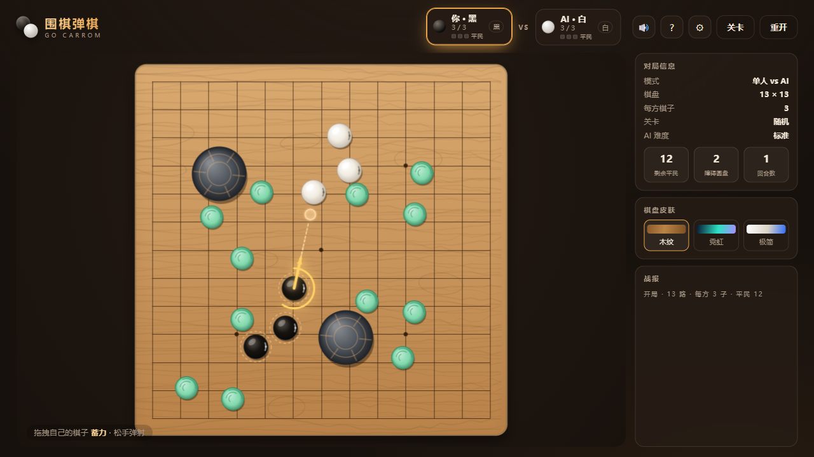

# 围棋弹棋 · Go Carrom

一个跑在浏览器里的**双人 / 单人 vs AI 弹棋游戏**：棋盘是围棋盘，棋子是冰壶手感——
拖拽蓄力、松手弹射、摩擦减速，把对方的棋子撞出棋盘边缘即可消灭，全部消灭即获胜。

纯前端、零依赖、零构建：**打开网页就能玩**。

🔗 **两个线上版本**（同一套引擎，两份入口）：

| 版本 | 地址 | 说明 |
| --- | --- | --- |
| 全功能版 | <https://cyzhou2.github.io/go-carrom/> | 可自由设置棋盘、子数、平民、障碍、AI 难度、瞄准方式，含关卡编辑器 |
| **默认设置版** | <https://cyzhou2.github.io/go-carrom/default/> | **去掉所有配置项**，按设备自动配好，打开就玩（保留教程、皮肤与字号） |



---

## 默认设置版（无障碍版）

`default/` 是一个"零设置"入口：没有开始面板里的各种选项，点「开始游戏」即为最佳预设。

| | 电脑（横屏） | 手机（竖屏） |
| --- | --- | --- |
| 棋盘 | 19×19 | 11×11 |
| 棋子 | 3 v 3 | 2 v 2 |
| 平民 | 50 | 15 |
| 障碍大圆盘 | 3 | 2 |
| AI | 标准 | 标准 |
| 平民罚则 | 每撞飞 3 个自选 1 子下场 | 同左 |
| 关卡 | 随机生成 | 随机生成 |
| 瞄准 | 拉弓式 | 拉弓式 |
| 皮肤 / 字号 | 可自选 | 可自选 |

- 预设写在 [`default/default.js`](default/default.js)，只改这个文件就能调；
- 页面壳由 `node test/sync-default.js` 从根目录 `index.html` 生成（改完根页面记得跑一次）；
- 实现方式：`window.GC_LOCK` 让 `js/ui.js` 隐藏所有配置项、按 `window.innerHeight > window.innerWidth` 选横/竖屏预设，并在每次开局前强制套用。

## 快速开始

| 方式 | 操作 |
| --- | --- |
| 在线直接玩 | 打开 <https://cyzhou2.github.io/go-carrom/>，手机可「添加到主屏幕」当 App 用 |
| 本机双击 | 双击 `index.html`（Chrome / Edge / Firefox 均可） |
| 本地服务（推荐调试） | `python test/devserver.py 8123` → 访问 `http://127.0.0.1:8123/`（已禁用缓存，改完代码刷新即生效） |
| 普通静态服务 | `python -m http.server 8123`（注意浏览器可能缓存旧 JS） |

> **版本确认**：左上角 logo 旁会显示版本号（如 `v6`）。改动后如果还看到旧行为，
> 多半是浏览器在读缓存的 `js/*.js` —— 用上面的 devserver，或 `Ctrl+F5` 强刷。

---

## 玩法规则

1. **轮流弹射**：每回合点住己方一颗棋子，向外拖拽瞄准并蓄力，松手弹射；棋子滑行摩擦减速停下后回合结束。
2. **击败敌人**：把对方棋子撞出棋盘边缘即将其消灭。对方棋子**全部被消灭时获胜**。
3. **平民有风险**：撞飞平民会累积「平民伤亡」——
   **每累计 3 个，你必须亲手选一颗自己的棋子下场**。细则：
   - 撞飞**第 1、2 个完全不罚**，只有第 3 个（以及 6、9…）才触发；
   - 罚的是**你自己点选的那颗**（棋盘上会红色高亮并显示向下箭头，点谁谁下场）；
   - **与弹射的那颗棋子无关**：就算弹射棋子自己出界（自灭），该交的棋子照交，不能靠自灭躲掉；
   - 顶部棋子卡片用 3 个小格 + `平民 n/3` 显示进度，`2/3` 时第 3 格会闪红预警；
   - 一次撞飞多个跨过 3 的倍数，就按差额连续交子（撞 6 个＝交 2 颗）。
   设置里也可切换为「随机失去己方一子」或「仅扣分」。
4. **障碍圆盘**：灰色大圆盘是**固定不动的无限质量**物体，撞上会剧烈反弹；斜着擦过它能让棋子带上自旋。
5. **别把自己弹下去**：己方棋子出界同样会被消灭，满力要留神。

### 操作
- **指向式**（默认）：从棋子朝目标方向拖拽，箭头指向即弹射方向。
- **拉弓式**：如弹弓一样反方向拉拽再松手。
- 拖拽时实时显示**预测轨迹**（虚线）与落点标记：撞到棋子、撞到障碍反弹、或飞出棋盘都会提示。
- 快捷键：`R` 重开一局，`Esc` 关闭弹窗 / 退出关卡编辑器。

---

## 可调设置（开始面板）

| 设置 | 范围 | 说明 |
| --- | --- | --- |
| 游戏模式 | 单人 vs AI / 双人同屏 | |
| 棋盘尺寸 | 7 / 9 / 11 / 13 / 15 / 17 / **19** 路 | 最大 19×19 |
| 每方棋子 | **1–5**（数字输入框） | 双方同数，最多 5v5 |
| 平民数量 | **0–60**（数字输入框） | 随机散布，越靠中部越密 |
| 障碍圆盘 | 0–12 | 使用关卡时由关卡决定（输入框会禁用） |
| 关卡 | 随机生成 / 已保存关卡 | 见下方「关卡编辑器」 |
| AI 难度 | 温和 / 标准 / 凶狠 | |
| 惩罚方式 | **每 3 个平民自选一子下场** / 随机一子 / 仅扣分 | |
| 瞄准方式 | 指向式 / 拉弓式 | |

**外观**（侧栏「外观」面板，选择会记住）：
- **棋盘皮肤**：木纹 / 霓虹 / 极简；
- **界面字号**：小 / 标准 / 大 / 特大 —— 通过 CSS 变量 `--fs` 缩放界面上所有文字，棋盘上的飘字也同步缩放。

---

## 移动端

- **竖屏优先**：手机上棋盘自动变成正方形并占满宽度，状态栏（棋子数 + `平民 n/3` 进度）在顶部两行，
  统计与外观面板在下方可横向滑动。
- **触控优化**：点选棋子的命中范围放大到 2.15 倍，平民惩罚点选放大到 2.4 倍；
  画布 `touch-action: none`，拖拽瞄准不会触发页面滚动；支持刘海屏安全区（`viewport-fit=cover` + `env(safe-area-inset)`）。
- **横屏**：自动切回左右布局（窄侧栏 + 大棋盘）。
- 建议在手机浏览器里「添加到主屏幕」，即可全屏无地址栏游玩。

---

## 数值与物理：全部在 `js/config.js`

**没有任何前台可调的物理参数**，全部集中在 `js/config.js`，改完刷新页面即可生效。
（调试时也可用 URL 参数临时覆盖，例如 `?error.speedSigmaRatio=0.08&physics.decel=1200`，刷新即失效。）

### 发射误差（符合真实世界的高斯散布）

```js
error: {
  enabled: true,
  speedSigmaRatio: 0.070,  // 速度误差方均根 = 该常数 × 预计速度（原 0.035，已翻倍）
  angleSigma: 0.0170,      // 角度误差方均根（弧度 ≈0.97°）（原 0.0085，已翻倍）
  minSpeedSigma: 5,        // 低速时的最小抖动
  launchSpinSigma: 4.5,    // 出杆残余自旋（rad/s 方均根）
  aiUsesError: true        // AI 试算是否使用同一误差模型
}
```

出杆时对「预计速度 / 方向」加一组**零均值正态噪声**：`σ_v = k_v · v_预计`、`σ_θ = k_θ`，
因此力度越大绝对偏差越大（相对偏差恒定），与真实弹射一致。自测会验证：
速度误差方均根 ≈ 7%、角度误差方均根 ≈ 0.017 rad、1σ 覆盖率 ≈ 68%、2σ ≈ 95%。

**注意**：AI 推演用的是同一套误差模型（每个候选实际也是一次带噪声的出杆），
所以它评估的就是它真能打出的球；凶狠难度还会对前几名候选做多次采样复评。

### 含角速度与摩擦的碰撞

- 每颗棋子都有**角速度 ω** 与转动惯量 `I = ½mr²`，碰撞时用**接触点速度**
  （`v + ω × r`）计算法向冲量与切向冲量；
- 切向冲量受**库伦摩擦**上限 `μ·j_n` 约束（`contactFriction`），斜撞会"搓"出旋转、正碰几乎不转；
- 桌面摩擦为恒定减速度（滑行距离严格 = `v²/2a`），另有角速度衰减 `spinDecel`；
- 可选**冰壶效应**：自旋产生垂直于速度的侧向加速度（`curlCoef`，默认很小，可设 0 关闭）；
- 棋子上带一枚随 `ω` 转动的标记，能直接看出它在转。

物理步长固定 `1/240s`，AI 推演与实机一致（可复现）。

---

## 摆盘：随机聚类，不在格点上

开局不是"摆标准阵型"，而是：

1. 黑方在棋盘下半部、白方在上半部各取一个**聚类中心**（`clusterY / clusterX`）；
2. 同方棋子以**黄金角**绕中心铺开、互相靠拢成一团（`clusterRing / clusterJitter` 调松紧），
   坐标是连续随机值，**不落在棋盘交叉点上**；
3. 双方聚类之间保证最小间距；随后随机撒平民（更偏中部，`civCenterBias`）、再放障碍盘；
4. 棋子太多放不下时，物理半径按 `maxFillRatio` 自动整体缩小，保证 19 路放得下 5v5 + 60 平民。

---

## 关卡编辑器（自制障碍）

点击顶栏 **关卡**（或开始面板的「编辑关卡」）进入编辑模式：

| 操作 | 说明 |
| --- | --- |
| 单击空白 | 放置一个障碍圆盘（尺寸＝当前半径设定） |
| 拖动圆盘中间 | 移动位置（自动限制在棋盘内） |
| **拖动圆盘外缘 / 右上角手柄** | **直接缩放这个圆盘** |
| **在圆盘上滚轮** | **直接缩放这个圆盘**（空白处滚轮改新圆盘默认半径） |
| 半径滑杆 / − + 按钮 / 数字框 | 精确设定百分比；选中圆盘时作用于它，未选中时作为新圆盘的默认值 |
| `[` `]` 键 | 缩小 / 放大 2% |
| 右键圆盘 | 删除 |
| 棋盘下拉 | 切换关卡所用的棋盘大小（7–19） |
| 保存 / 读取 / 删除 | 存在浏览器本地（localStorage） |
| 导出 / 导入 | 存成 `.json` 文件，可分享或做版本管理 |
| 用此关卡开局 | 立刻按当前布局开一局 |

关卡文件格式（坐标归一化到 0–1，半径是棋盘边长的比例，因此换棋盘尺寸会等比缩放）：

```json
{
  "name": "三盘测试",
  "board": 19,
  "obstacles": [
    { "x": 0.312, "y": 0.345, "r": 0.075 },
    { "x": 0.33,  "y": 0.613, "r": 0.16  }
  ]
}
```

对局中侧栏「关卡」一栏会显示当前关卡名。

---

## AI 是怎么想的

1. **生成候选**：每颗己方棋子 × 每个敌方棋子 × 多档力度（含侧擦角度）、障碍反弹球、若干随机球；
   大棋盘上候选过多时按每颗棋子配额抽样（`difficulty.*.cap`）。
2. **推演**：用与实机**完全相同的固定步长物理 + 同一套出杆误差**，把候选跑到静止（初筛 3.5s，复评 6s）。
3. **评分**：击落敌子 `+150`、自损 `-130`、撞飞平民 `-70`（若己方已有 2 个平民伤亡、再撞一个就要付棋子，则代价 ×3）；
   逼向边缘 / 自身暴露边缘也有加减分。
4. **决策**：温和档按 softmax 在若干好棋中随机挑并带较大手抖；凶狠档对前 5 名做多次采样复评，
   再扣掉**对手最佳回应**的收益后选最好的一手。

实测耗时：9 路约 0.1s；19 路 + 60 平民约 0.7s（凶狠约 1.8s）。

---

## 目录结构

```
goCarrom/
├─ index.html          全功能版页面（HUD / 侧栏 / 开始与结算面板 / 编辑器工具条 / 规则）
├─ default/            默认设置版（零配置入口）
│  ├─ index.html       由 test/sync-default.js 从根 index.html 生成
│  └─ default.js       ★ 横屏 / 竖屏两套预设
├─ css/style.css       全部样式（皮肤 html[data-skin]、字号 html[data-size] 变量切换）
├─ js/
│  ├─ util.js          数学、颜色、正态采样、可复现随机数
│  ├─ config.js        ★ 全部可调参数（物理 / 误差 / 布局 / AI / 难度 / 规则上限）
│  ├─ physics.js       顶视冰壶物理：摩擦、自旋、接触摩擦、无限质量障碍、空间网格粗筛
│  ├─ ai.js            AI 候选生成 + 推演评分 + 三档难度
│  ├─ editor.js        关卡编辑器模型：增删改、归一化、本地存储、导入导出
│  ├─ render.js        Canvas 渲染：棋盘缓存、棋子与自旋标记、瞄准轨迹、粒子、出界动画
│  ├─ audio.js         WebAudio 合成音效（无外部音频资源）
│  ├─ game.js          对局状态机：聚类摆盘、回合、惩罚、关卡接入、胜负
│  └─ ui.js            指针交互、HUD、设置、关卡编辑器界面、渲染循环、默认版锁定
└─ test/
   ├─ selftest.js      无浏览器规则自测（node test/selftest.js）
   ├─ sync-default.js  重新生成 default/index.html
   ├─ devserver.py     禁用缓存的开发服务器（python test/devserver.py 8123）
   └─ artifacts/       开发期浏览器调试快照（可选，已 gitignore）
```

## 部署（GitHub Pages）

仓库：<https://github.com/cyzhou2/go-carrom>

| 版本 | 线上地址 |
| --- | --- |
| 全功能版 | <https://cyzhou2.github.io/go-carrom/> |
| 默认设置版 | <https://cyzhou2.github.io/go-carrom/default/> |

- 站点是纯静态的，**仓库根目录就是网站根目录**（`index.html` 在根上，`default/` 是子目录）；
- Pages 设置：`Settings → Pages → Source: Deploy from a branch → main / (root)`；
- 仓库里有 `.nojekyll`，避免 GitHub 用 Jekyll 处理静态文件；
- **更新方式**：改完代码后 `git add -A && git commit -m "..." && git push`，Pages 会自动重新构建（约 1 分钟）。
  改了根 `index.html` 记得先跑 `node test/sync-default.js`，让默认版权同步。

## 自测

```bash
node test/selftest.js
```

覆盖：摩擦 / 碰撞 / 自旋 / 无限质量障碍、**误差正态分布与方差**、7–19 路随机聚类摆盘
（数量、无重叠、成团、不落格点、19 路 60 平民）、击落与平民罚则
（**1 个 / 2 个不罚、3 个才罚、自灭照罚、跨倍数连续交子**）、**关卡增删改查与导入导出**、
AI 出招合法性，以及三档难度的 AI 自我对局能否自然分出胜负。

---

## 实现要点

- **确定性**：AI 推演与实机共用同一物理步长与误差模型，所以"它以为的"和"它打出的"一致。
- **性能**：碰撞用空间网格粗筛（障碍盘按包围盒占多个格子），70+ 棋子时单步约 20–50µs；
  AI 分片执行不阻塞界面。
- **渲染**：棋盘（木板 + 网格 + 星位 + 纹理）预渲染到离屏 Canvas，每帧只做 `drawImage`；
  棋子用径向渐变 + 高光 + 阴影 + 自旋标记，撞击闪白、出界缩放旋转淡出。
- **无外部资源**：没有图片、字体、音频文件，全部程序化绘制 / 合成。
